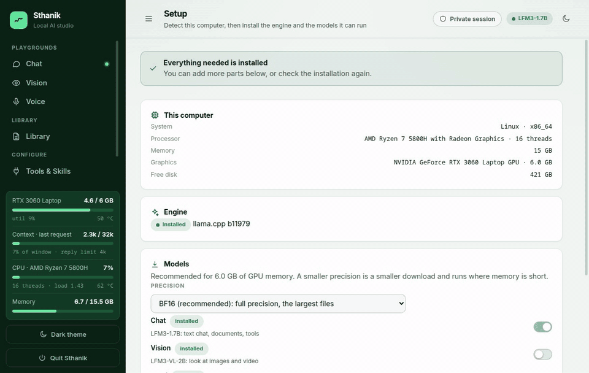
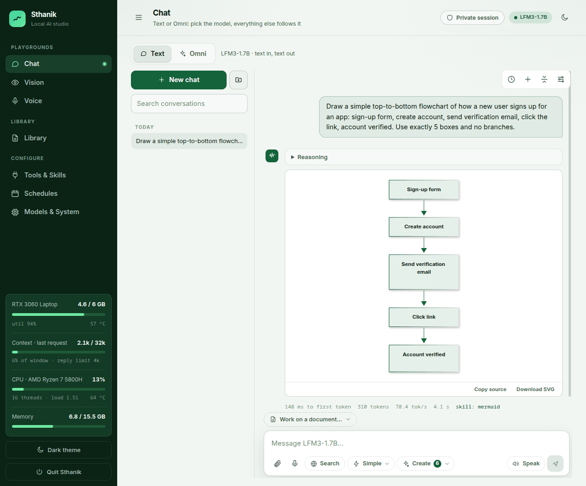
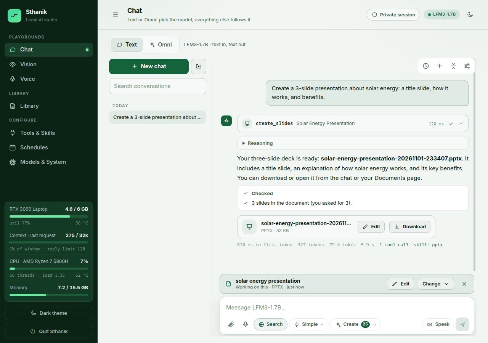
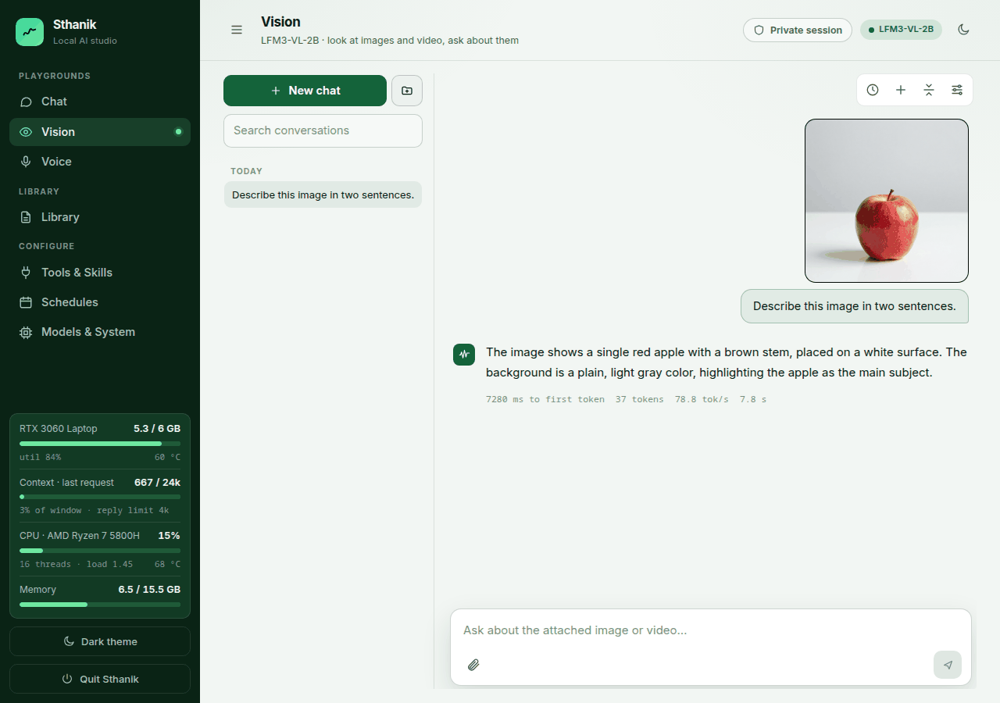
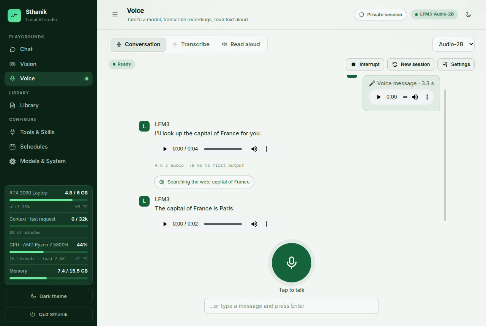
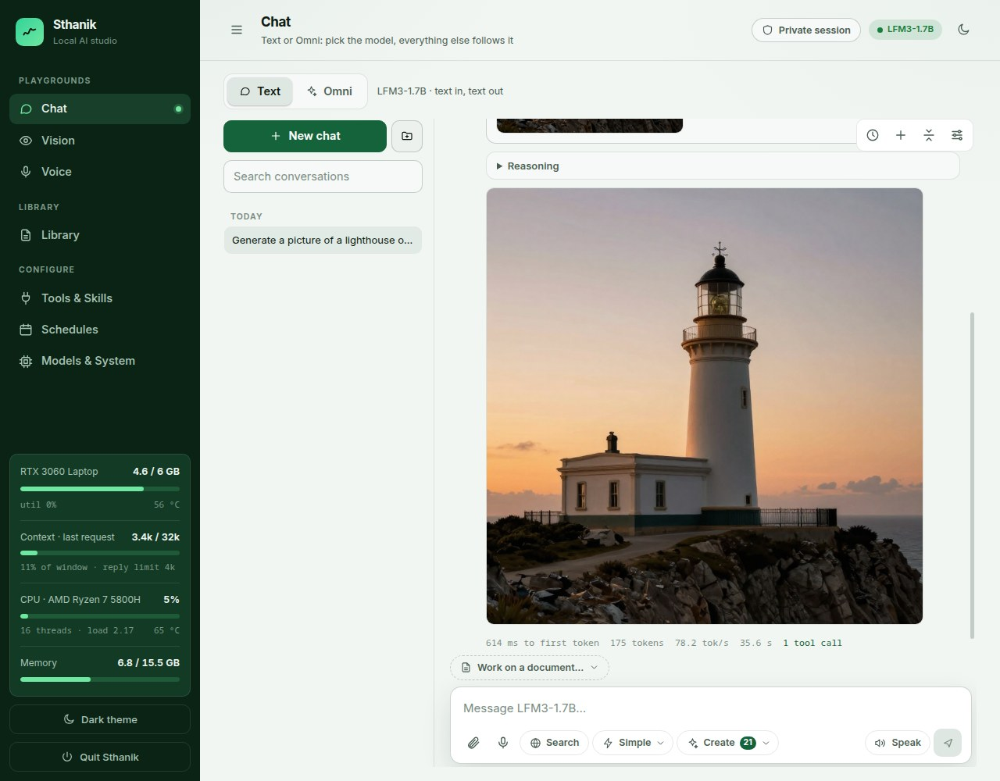
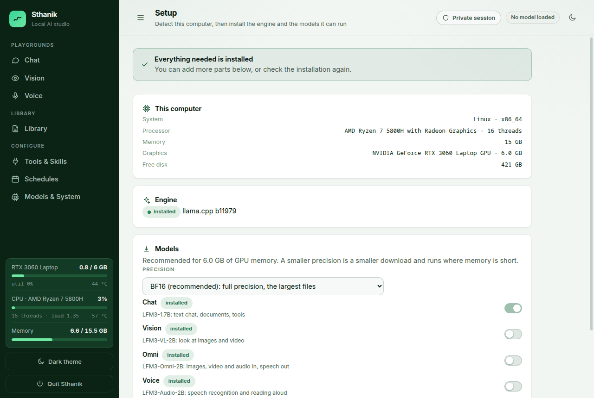
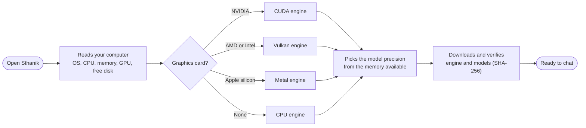
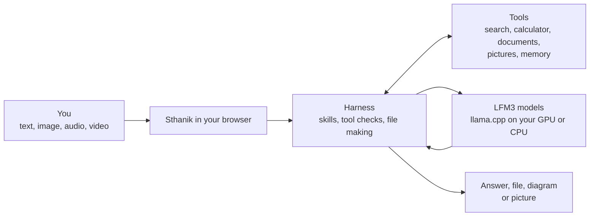

  

<h1 align="center">Sthanik</h1>

  <b>A local AI studio for Liquid AI's LFM3 models.</b> 
  Chat, look at images and video, talk, write documents, draw diagrams and make pictures, all on your own computer.

  
  
  

  <a href="https://github.com/RanaShiva/sthanik/releases/latest"><b>Download</b></a> ·
  <a href="#install">Install</a> ·
  <a href="docs/GUIDE.md">Full guide</a>

Sthanik (स्थानिक, "local") runs the models through [llama.cpp](https://github.com/ggml-org/llama.cpp) on your own GPU or CPU, and draws pictures with [stable-diffusion.cpp](https://github.com/leejet/stable-diffusion.cpp). There is no account to make. On first run it **looks at your computer and sets itself up**: it picks the engine and the model size that suit your hardware, then downloads and verifies them.

## What you can do

| | |
|:--|:--|
|  |  |
| **Ask for a diagram.** Describe a process and get a flowchart, sequence diagram or timeline you can copy or save as SVG. | **Make real files.** Word, PowerPoint, Excel, PDF and web pages, checked against what you asked for ("3 slides, you asked for 3"). |
|  |  |
| **Look at images and video.** Ask what is in a picture, read text from a photo, summarise a clip. | **Talk to it.** Ask out loud and hear the answer. It can look things up, and it also transcribes recordings and reads text aloud. |
|  |  |
| **Draw pictures.** Describe a scene and a local image model draws it, or have it find a real photo and credit the source. | **Sets itself up.** Reads your operating system, processor, memory, graphics card and free disk, then installs what fits. |

Also in the box: a long-term memory you control, "skills" that teach the model how to lay out each kind of file, scheduled prompts, any MCP tool server, a **Complex** mode that makes a to-do list and researches each item, and a **Private session** switch that keeps a session off the disk. Light and dark themes ([dark screenshot](docs/images/dark.png)).

## How it works

**First run.** Nothing is bundled; the app chooses what to download for the computer it is on.

**Every message.** The model is small, so the app does the careful work around it.

Nothing leaves your computer except the downloads during setup (github.com for the engine, huggingface.co for the models), and the searches and pages it fetches when you switch **Search** on.

## Install

Download the file for your system from the [**Releases**](https://github.com/RanaShiva/sthanik/releases/latest) page:

| System | File | Then |
|---|---|---|
| Windows 10/11 (64-bit) | `Sthanik-<version>-windows-x64-setup.exe` (installer) or `…-windows-x64.zip` | Start it from the Start menu. A console window stays open while it runs; closing it quits. |
| macOS (Apple silicon or Intel) | `Sthanik-<version>-macos-arm64.dmg` / `…-macos-x86_64.dmg` | Drag *Sthanik* to Applications, then **right-click → Open** the first time. |
| Linux (x86-64 or arm64) | `Sthanik-<version>-linux-<arch>.tar.gz` | `tar xzf` it and run `./install.sh` (adds it to your applications menu, no root needed), or run `./sthanik/sthanik`. Needs glibc 2.35 or newer (see below). |

Sthanik opens in your browser at `http://127.0.0.1:7860` and shows **Setup** on first run. The Windows and macOS programs are **not code-signed**, so SmartScreen or Gatekeeper warns the first time you open them. Every release lists a SHA-256 for each file (`SHA256SUMS`). No browser handy? `sthanik --setup --parts text,vl` installs from the terminal.

**Linux systems.** The package is tried in containers of Ubuntu 22.04 and 24.04, Debian 12, Fedora, Arch and openSUSE Tumbleweed: it starts, passes its self-test, installs and uninstalls. It needs glibc 2.35 or newer, because the llama.cpp engine it downloads does; older systems (Ubuntu 20.04, Debian 11, RHEL, Rocky and Alma 9 and earlier) are refused by `install.sh` with a message, and Alpine is not supported.

**Uninstall.** Windows: *Settings → Apps → Sthanik* (the installer registers an uninstaller). macOS: drag *Sthanik* from Applications to the Trash. Linux: `sthanik-uninstall` (it stays installed, so you do not need the extracted folder). None of these delete your chats, documents and models; on Linux add `--purge` to delete them too, and elsewhere delete the data folder named in the [guide](docs/GUIDE.md).

From source (needs Python 3; the downloads above need nothing installed): see the [guide](docs/GUIDE.md#run-from-source).

## Status

The Linux x86-64 build has been used on a real machine (NVIDIA RTX 3060, 6 GB). The Windows, macOS and Linux arm64 builds are built, started and self-tested by GitHub's runners on every release, but have **not** been run on real hardware, and AMD, Intel and Apple GPUs are untested. If something does not work on yours, please [open an issue](https://github.com/RanaShiva/sthanik/issues).

## Learn more

[**The full guide**](docs/GUIDE.md) covers every page, [private session](docs/GUIDE.md#private-session), [privacy and security](docs/GUIDE.md#privacy-and-security), [memory](docs/GUIDE.md#memory), [diagrams](docs/GUIDE.md#diagrams-mermaid), [images](docs/GUIDE.md#images), [changing models](docs/GUIDE.md#changing-models), [skills](docs/GUIDE.md#skills) and [scheduled tasks](docs/GUIDE.md#scheduled-tasks).

## License

Sthanik's own code is [MIT licensed](LICENSE). The models it runs are separate works with their own licenses: the LFM3 weights use the LFM Open License v1.0 (check it before commercial use), and Z-Image-Turbo and Qwen3 have their own.
