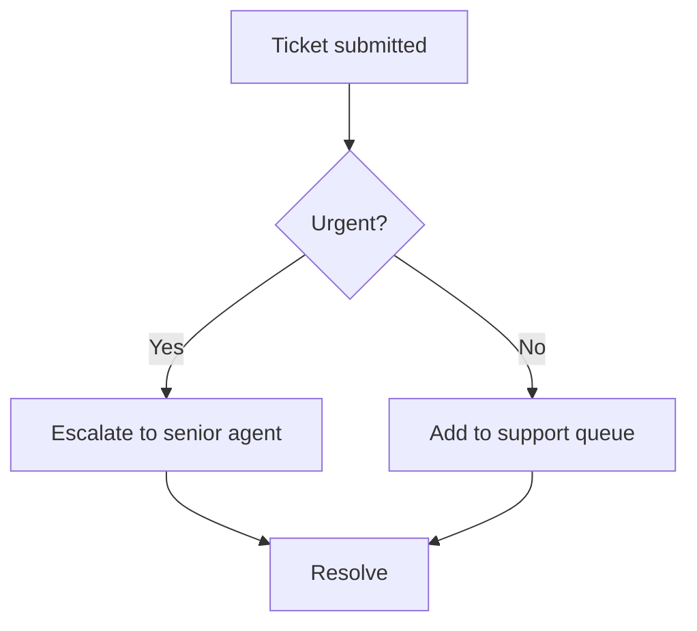

# Drawing diagrams

Write the diagram as a fenced code block whose language is `mermaid`. The app draws it automatically in chat, and inside documents and slides it becomes a picture in the PDF, Word or PowerPoint file. **Never describe a diagram in words when asked to draw one, and never use ASCII art.**

````

````

## Pick the type
| Show | Start with |
|---|---|
| steps, decisions, process | `flowchart TD` (top-down) or `flowchart LR` (left-right) |
| who talks to whom, in order | `sequenceDiagram` |
| schedule, project plan | `gantt` |
| states and transitions | `stateDiagram-v2` |
| database tables | `erDiagram` |
| classes / code structure | `classDiagram` |
| brainstorm, topic breakdown | `mindmap` |
| history, roadmap | `timeline` |
| shares of a whole | `pie title Name` |

## Templates (copy the shape exactly)
```
sequenceDiagram
  participant U as User
  participant A as App
  U->>A: Ask a question
  A-->>U: Reply
```
```
gantt
  title Launch plan
  dateFormat YYYY-MM-DD
  section Build
  Design :a1, 2026-11-01, 10d
  Develop :after a1, 15d
```
```
mindmap
  root((Local AI))
    Benefits
      Privacy
      Cost
    Risks
      Hardware
```
```
timeline
  title Roadmap
  2026 Q1 : Prototype
  2026 Q2 : Pilot
```
```
pie title Budget
  "Hardware" : 45
  "People" : 40
  "Other" : 15
```

## Syntax rules that avoid errors
- Node ids are short and plain: `A`, `B`, `step1`. The visible text goes in brackets: `A[Text here]`; decisions use braces `B{Question?}`; rounded `C(Text)`.
- **Put label text in double quotes whenever it has brackets, commas, colons, slashes or quotes**: `A["Review (manual)"]`.
- Edge text goes between pipes: `B -->|Yes| C`. Dotted: `-.->`. Thick: `==>`.
- Do not name a node `end`, and do not use the words `graph`, `subgraph` or `class` as ids.
- Keep a diagram to 5-12 nodes. Split bigger ones into two diagrams.
- One statement per line, two-space indents. No semicolons, no HTML tags, no emoji.
- Group related nodes with `subgraph Name` ... `end` only when it clarifies something.

## In documents and slides
- In a **document** (`create_document`), put the block in the Markdown where the diagram belongs, with a sentence before it saying what it shows.
- In **slides** (`create_slides`), give the diagram its own slide: a `## Slide title` heading, then the mermaid block and nothing else.
- If the tool replies that a diagram could not be drawn, read the error, fix that line and call the tool again.
- After the diagram, add one sentence on what it shows. Do not repeat its contents as a list.
